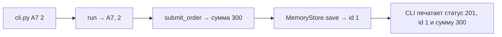

Проект оформляет заказ из командной строки. На примере из README команда `python3 -B cli.py A7 2` принимает код товара `A7` и количество `2`, сохраняет заказ в памяти и печатает `{'status': 201, 'id': 1, 'total': 300}`. [README.md](/private/var/folders/8k/h7q4305x2_99njry5v0zh00h0000gn/T/study-trace-eval.mc8CS4Y7/workspaces/trace-main/README.md:3)

**Карта проекта.** `cli.py` принимает аргументы и выводит результат. `orders.py` проверяет количество, считает сумму и передаёт заказ на сохранение. `storage.py` хранит заказы в списке, который живёт только в рамках процесса. `test_trace.py` вызывает ту же функцию `run`, подставляя тестовое хранилище.

### Как проходит заказ `A7 2`

1. При запуске `cli.py` выражение `sys.argv[1:]` передаёт в `run` список `["A7", "2"]`. В `run` параметр `type=int` преобразует строку `"2"` в число `2`. Затем функция вызывает `submit_order("A7", 2, store_factory)`, где фабрика по умолчанию — `MemoryStore`. [cli.py · запуск](/private/var/folders/8k/h7q4305x2_99njry5v0zh00h0000gn/T/study-trace-eval.mc8CS4Y7/workspaces/trace-main/cli.py:16) · [cli.py · run](/private/var/folders/8k/h7q4305x2_99njry5v0zh00h0000gn/T/study-trace-eval.mc8CS4Y7/workspaces/trace-main/cli.py:8)
2. В `submit_order` условие `quantity < 0` для `2` ложно. Функция вычисляет `2 * 150 = 300`, создаёт хранилище через `store_factory()` и передаёт в `save` словарь `{"sku": "A7", "quantity": 2, "total": 300}`. [orders.py · submit_order](/private/var/folders/8k/h7q4305x2_99njry5v0zh00h0000gn/T/study-trace-eval.mc8CS4Y7/workspaces/trace-main/orders.py:4)
3. `MemoryStore.save` добавляет заказ в пустой список и возвращает его новую длину `1`. `submit_order` использует её как `id` в результате со статусом `201`, а точка входа печатает этот результат. [storage.py · MemoryStore](/private/var/folders/8k/h7q4305x2_99njry5v0zh00h0000gn/T/study-trace-eval.mc8CS4Y7/workspaces/trace-main/storage.py:1) · [orders.py · возврат результата](/private/var/folders/8k/h7q4305x2_99njry5v0zh00h0000gn/T/study-trace-eval.mc8CS4Y7/workspaces/trace-main/orders.py:10)

### Где меняется маршрут

При отрицательном количестве `submit_order` сразу возвращает `{"status": 422}`, до создания хранилища. Для нуля README обещает тот же результат, но условие `0 < 0` ложно. Я запустил `python3 -B cli.py A7 0` и получил `{'status': 201, 'id': 1, 'total': 0}`. Тест на отклонение нуля падает по той же причине. [README.md · правило количества](/private/var/folders/8k/h7q4305x2_99njry5v0zh00h0000gn/T/study-trace-eval.mc8CS4Y7/workspaces/trace-main/README.md:5) · [orders.py · проверка](/private/var/folders/8k/h7q4305x2_99njry5v0zh00h0000gn/T/study-trace-eval.mc8CS4Y7/workspaces/trace-main/orders.py:5) · [test_trace.py · тест нуля](/private/var/folders/8k/h7q4305x2_99njry5v0zh00h0000gn/T/study-trace-eval.mc8CS4Y7/workspaces/trace-main/test_trace.py:16)

Тест для `A7 2` проходит с `StubStore`: он проверяет итоговый словарь со статусом `201`, суммой `300` и идентификатором `"test-order"`, который возвращает заглушка. Идентификатор `1` от настоящего `MemoryStore` я подтвердил отдельным запуском CLI. [test_trace.py · заглушка и тест успешного заказа](/private/var/folders/8k/h7q4305x2_99njry5v0zh00h0000gn/T/study-trace-eval.mc8CS4Y7/workspaces/trace-main/test_trace.py:6)